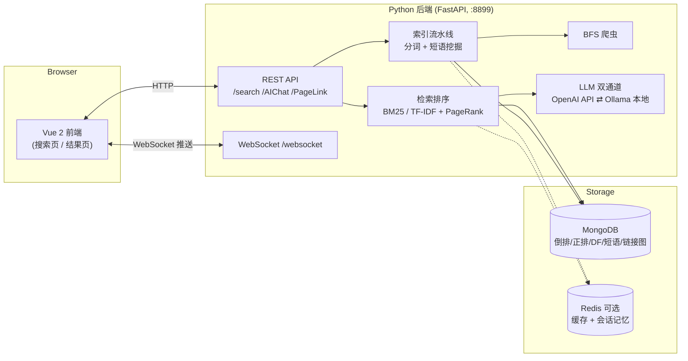

<div align="center">
  
</div>

# ARC Search Engine / 弧光搜索引擎

一个**从零实现、单进程可运行**的全栈搜索引擎 demo：分布式爬虫 → 倒排索引 → BM25/TF-IDF 检索 → PageRank 排序 → LLM 增强搜索（查询扩展 / RAG 摘要 / AI 助手），用 **Python (FastAPI) + Vue** 实现。

> 课程作业时代的原始架构为「Java Spring Boot 后端 + Python Tornado 算法服务 + Vue 前端」三个服务。
> 现已将 Java 后端的功能完整重写进 Python，与算法服务合并为**单进程后端**，一键即可启动；
> 原始 Java 实现保留在 git 历史中（`git log --stat` 可查）。

## ✨ 特性

**搜索引擎核心**

- 🕷️ **礼貌爬虫**：BFS 抓取，遵守 robots.txt（君子协议），可配置 UA / 超时 / 深度 / 配额
- 🔤 **子词分词**：基于 GPT-2 BPE tokenizer，天然支持任意 UTF-8 语言（中英混排无需定制分词器）
- 📖 **短语挖掘**：Apriori 风格逐层连词挖掘，自动从语料发现高频短语（如"赛博朋克2077"），短语作为整体参与检索并加权
- 🗂️ **倒排索引**：标题/正文双路倒排 + DF 表 + 正排表，存于 MongoDB
- 📊 **双排序模型**：Okapi BM25（默认，BM25F 风格标题加权）与 TF-IDF + 余弦相似度（课程原版算法）可通过环境变量一键切换
- 🔗 **PageRank 重排序**：对爬取链接图做幂迭代，`final = relevance × (1 + w × pagerank)` 融合内容相关性与链接权威性
- ⚡ **缓存**：DF 表 / 短语表 / 语料规模进缓存，Redis 可选（无 Redis 自动降级进程内缓存）

**LLM 增强**

- 🔎 **查询扩展**：LLM 以 few-shot prompt 生成同义词，扩展召回
- 📝 **RAG 式摘要**：检索完成后异步将 query + Top5 结果交给 LLM 生成带小标题的总结，经 WebSocket 推送
- 💬 **AI 助手**：带人设（"弧光天星"）的多轮对话，会话记忆存于缓存并设 TTL
- 🔁 **双通道降级**：OpenAI 兼容 API 优先，失败自动回落到 Ollama 本地模型（离线可用）

**工程**

- 🚀 **一键启动**：`python main.py` 单进程承载 REST + WebSocket + 爬虫 + LLM 调度
- 🔔 **实时推送**：WebSocket 广播爬虫进度 / 相关词 / AI 摘要
- ✅ **38 项集成测试**：无外部依赖即可跑通"建索引 → 检索 → 排序 → API"全链路（`backend/test_integration.py`）
- 🔐 **无硬编码配置**：全部环境变量注入，密钥不入库

## 🏗️ 架构



搜索流程、索引流程、数据模型的详细说明见 [docs/architecture.md](docs/architecture.md)；
各算法的设计动机与公式见 [docs/search-pipeline.md](docs/search-pipeline.md)；
LLM 三个应用点的 prompt 设计见 [docs/llm.md](docs/llm.md)。

## 🚀 快速开始

### 0. 环境要求

- Python 3.10+，MongoDB 4.4+（或 Docker）
- 前端（可选）：Node 14–16（老 webpack 工具链，Node 18+ 需自行升级）

### 1. 启动 MongoDB

```bash
docker compose up -d        # 仅 MongoDB
# docker compose --profile redis up -d   # 需要 Redis 缓存时
```

### 2. 启动后端

```bash
cd backend
pip install -r requirements.txt

# LLM 配置（可选：不配置时 LLM 相关功能自动回落 Ollama 或返回 502）
set LLM_API_KEY=sk-xxx            # Windows
# export LLM_API_KEY=sk-xxx       # Linux / macOS

python main.py
```

看到 `ARC search engine ready: http://0.0.0.0:8899` 即启动完成。

### 3. 搜索体验

前端（可选）：

```bash
cd frontend && npm install && npm run dev   # http://localhost:8080
```

或者直接用 HTTP 接口：

```bash
# 1) 让爬虫抓取起始站点（url 最大子页数）
curl -X POST http://localhost:8899/PageLink/Parse ^
  -H "Content-Type: application/json" ^
  -d "{\"urls\": \"https://docs.python.org 20\"}"

# 2) 搜索
curl -X POST http://localhost:8899/search/get ^
  -H "Content-Type: application/json" ^
  -d "{\"keywords\": \"如何安装 python\"}"
```

Windows 下一键启动前后端：双击根目录 `start.bat`。

### 4. 运行测试（无需 MongoDB / LLM）

```bash
cd backend
pip install mongomock httpx pytest httpx
python test_integration.py     # 38 项断言覆盖 索引→检索→排序→API→WebSocket
```

## ⚙️ 配置（环境变量）

| 变量 | 默认值 | 说明 |
| --- | --- | --- |
| `MONGO_URI` / `MONGO_DB` | `mongodb://localhost:27017` / `ARC_ENGINE` | MongoDB 连接 |
| `REDIS_URL` | （空） | 设置后启用 Redis 缓存，否则用进程内缓存 |
| `SCORE_MODE` | `bm25` | 排序模型：`bm25` 或 `tfidf` |
| `TITLE_BOOST` | `10.0` | 标题命中权重 |
| `PAGERANK_WEIGHT` | `1.0` | PageRank 融合强度（0 = 关闭链接排序） |
| `TOP_RESULTS` | `50` | 返回结果上限 |
| `LLM_API_KEY` / `LLM_BASE_URL` / `LLM_MODEL` | （空）/ OpenAI / `gpt-3.5-turbo` | 远程 LLM 通道 |
| `OLLAMA_MODEL` | `llama2-chinese` | 本地兜底模型 |
| `CRAWLER_MAX_DEPTH` / `CRAWLER_RESPECT_ROBOTS` | `3` / `true` | 爬虫深度 / 是否遵守 robots.txt |

完整列表见 [backend/config.py](backend/config.py)。

## 📁 目录结构

```
├── backend/                 Python 单体后端（FastAPI）
│   ├── main.py              入口：REST 路由 + WebSocket + 线程池调度
│   ├── search_engine.py     检索：倒排查询 → BM25/TF-IDF → PageRank 重排
│   ├── indexer.py           索引流水线：分词 → 倒排/正排 → 短语表 → 链接图 → PageRank
│   ├── tokenizer.py         GPT-2 分词 + Apriori 短语挖掘
│   ├── pagerank.py          PageRank 幂迭代
│   ├── ai.py                LLM 双通道 + 查询扩展 + AI 助手
│   ├── crawler.py           BFS 爬虫（robots.txt 合规）
│   ├── storage.py           MongoDB 集合封装 + Redis 可选缓存
│   ├── textproc.py          文本预处理 + 查询短语提取
│   └── test_integration.py  38 项集成测试
├── frontend/                Vue 2 + Element UI 前端
├── docs/                    架构 / 算法 / LLM 设计文档
├── docker-compose.yml       MongoDB（+ 可选 Redis）
└── start.bat                Windows 一键启动
```

## 🙏 致谢

本项目源于一门课程作业的团队协作，原始架构中：

- **算法模块（爬虫 / 分词 / LLM）** 与整体设计、本次 Python 重构：[DEVILENMO](https://github.com/DEVILENMO)
- **Java 后端**（已重写为 Python，特此致谢）：[Wish-You-Hell](https://github.com/Wish-You-Hell)、[MeteorTony](https://github.com/MeteorTony)
- **Vue 前端**：[Wish-You-Hell](https://github.com/Wish-You-Hell)

## License

GPL-3.0
