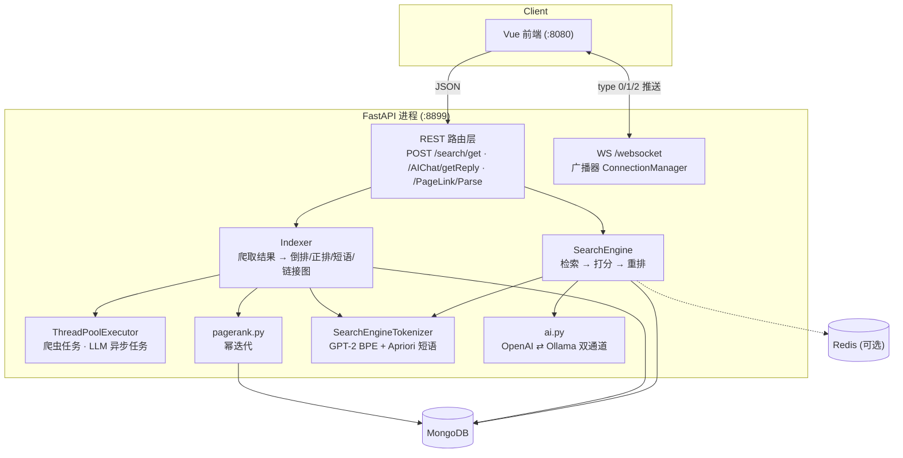
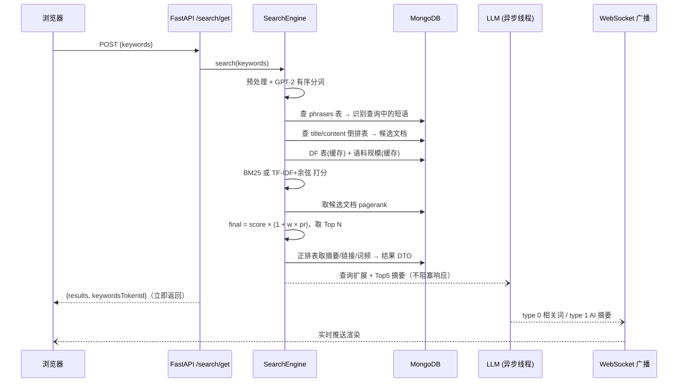
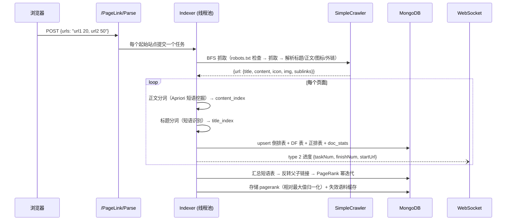

# 架构与数据模型

## 组件拓扑

单进程 Python 后端（FastAPI / uvicorn，端口 8899）承载全部服务端逻辑；MongoDB 为唯一必需的存储依赖，Redis 可选。

## 数据模型（MongoDB 集合）

历史版本沿用下来的六张表。倒排表的 key 约定：token id 为十进制字符串，**短语**（连词）用 `-` 连接各 token id（如 `"233-164-113"`）；URL 在倒排表内以 `$` 代替 `.` 存储（规避 MongoDB 旧版字段名限制）。

| 集合 | 类型 | Schema | 说明 |
| --- | --- | --- | --- |
| `title_index` | 倒排 | `{_id: tokenId, indexMap: {url$: {url, tf}}}` | 标题词 → 文档列表 |
| `content_index` | 倒排 | 同上 | 正文词 → 文档列表 |
| `stem_df` | 统计 | `{_id: tokenId, df}` | 文档频率，IDF 计算输入 |
| `phrases` | 统计 | `{_id: phraseId, df}` | 短语表，查询侧短语识别的字典 |
| `forward_index` | 正排 | `{url, title, content, title_tf, content_tf, icon, img, articleId, childrenLink[], parentLink[], pagerank}` | 摘要/展示/链接图来源 |
| `doc_stats` | 统计 | `{url, title_len, content_len}` | BM25 的文档长度与平均长度 |

## 搜索时序

关键设计：

- **LLM 调用不阻塞搜索响应**。相关词与摘要在线程池中执行，经 WebSocket 异步推送（前端在结果页独立渲染这两个区域）。
- **DF 表与短语表整表缓存**，只在索引变更时失效。原 Java 实现每次搜索全表扫描 `stem_df`，是明显的性能热点。

## 爬虫与索引时序

## 与课程原版的差异

| 维度 | 原版 | 现在 |
| --- | --- | --- |
| 后端 | Java Spring Boot + Python Tornado 双服务 | Python 单进程 |
| 排序 | TF-IDF + 余弦 | BM25（默认）/ TF-IDF 可切换，均叠加 PageRank |
| 链接分析 | 仅存链接图，不参与排序 | PageRank 幂迭代参与排序 |
| DF/短语查询 | 每次搜索全表扫描 | 整表缓存 + 索引变更时失效 |
| 内部调用 | Java → Tornado HTTP | 同进程函数调用 |
| 配置 | 外部地址硬编码在代码里 | 全部环境变量 |
| 会话记忆 | Redis 无过期 | 缓存 + TTL |
| 已修复 bug | `updateParent` 写错父链接 + NPE；排序分数错位；`eval()` RCE；爬虫无超时；爬虫进度/搜索无隔离 | 全部修复 |
